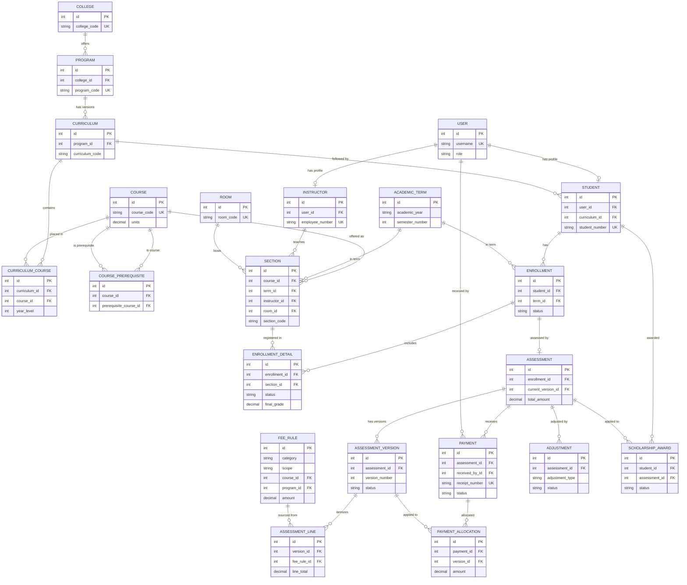

# E3 — Final ERD and Differences from the Original

The **original ERD source is preserved** in `erd_artifacts/`
(`ADS_Enrollment_System_Simplified_ERD.png`, `..._Schema.sql`, `....mwb`). That
artifact reflects the **pre-Milestone-A/B** schema (the original 15 business
tables, crow's-foot notation). It was **not modified**. This document provides an
**updated final-schema ERD** reflecting Milestones A (Room) and B (finance
versioning/ledger), and lists the differences.

> The live database schema was **not** changed to produce this document.

## Differences vs. the original `erd_artifacts/` ERD

**Added in Milestone A (scheduling):**
- New entity **`room`**; `section` gained a nullable FK **`room`** (legacy
  `room_code` retained).

**Added in Milestone B (finance):** new entities
- **`fee_rule`**, **`assessment_version`**, **`assessment_line`**,
  **`payment_allocation`**, **`adjustment`**, **`scholarship_award`**,
  **`finance_policy`**, **`reconciliation`**, **`finance_audit_log`**.
- `assessment` gained `current_version` (FK→assessment_version, SET_NULL) and
  `needs_review`.
- `payment` gained statuses (PENDING/REVERSED), method E_WALLET, `reference_note`,
  `reversed_at`.

Business tables: **15 → 25**.

## Final ERD (Mermaid; crow's-foot cardinalities)

`||` = exactly one · `o{` = zero-or-many · `|{` = one-or-many · `o|` =
zero-or-one. Attributes are abbreviated to keys for readability.

> `FINANCE_POLICY` (single-row config), `RECONCILIATION`, and `FINANCE_AUDIT_LOG`
> are standalone finance tables not shown above (few/no cross-entity relations:
> policy is a singleton; reconciliation and audit-log reference a user/term
> loosely). They are documented in `../database_documentation.md`.

## Explanation

Cardinalities follow the model FKs: a `USER` has at most one `STUDENT` **or**
`INSTRUCTOR` profile (OneToOne); a `COLLEGE` offers many `PROGRAM`s; a `SECTION`
belongs to one course/term and optionally one instructor and one room; an
`ENROLLMENT` (one per student per term) has many `ENROLLMENT_DETAIL`s; an
`ENROLLMENT` has at most one `ASSESSMENT`, which owns many immutable
`ASSESSMENT_VERSION`s (one marked current), each itemized by `ASSESSMENT_LINE`s;
`PAYMENT`s are linked to versions through `PAYMENT_ALLOCATION`s. All FKs are
`PROTECT` except `ASSESSMENT.current_version` and `FINANCE_AUDIT_LOG.actor`
(`SET_NULL`).
