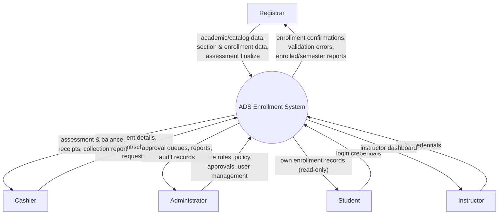

# E2 — Data Flow Diagram: Context (Level 0)

A single central process (the system) with the five external entities and the
major data flows between them. Mermaid source below.

## Legend / notation

- **Central process** = the whole ADS Enrollment System (one process at context
  level).
- **External entities** = the five user roles (sources/sinks of data).
- **Arrows** = data flows (label = the data moving).

## Explanation

The context diagram treats the entire application as one process. Registrars
supply academic, scheduling, and enrollment data and receive confirmations and
enrollment reports. Cashiers supply payments and receive assessments, balances,
receipts, and the collection report. Administrators configure fee rules/policy,
approve finance actions, and manage users, receiving approval queues, reports,
and audit information. Students and instructors authenticate and receive
read-only views appropriate to their role. The Level-1 diagram
([dfd_level_1.md](dfd_level_1.md)) decomposes this single process into the
functional processes and data stores.
