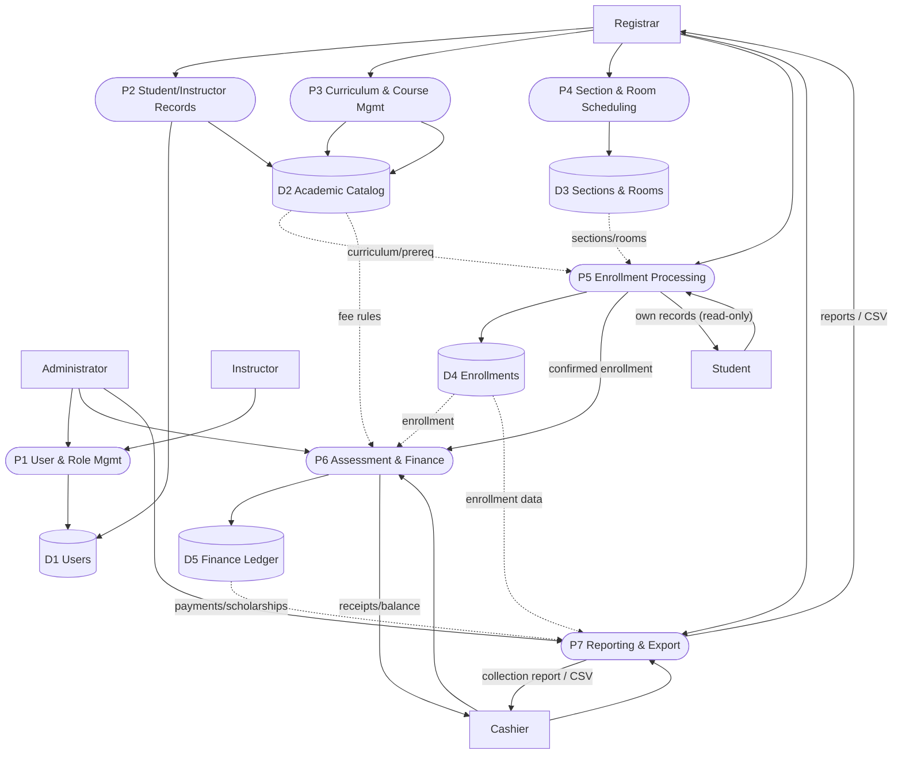

# E2 — Data Flow Diagram: Level 1

Decomposes the system into functional processes and data stores that mirror the
actual Django apps, models, and services. Mermaid source below.

## Legend / notation

- **Pn (rounded)** = processes. **Dn (cylinders)** = data stores (database
  tables). **Actors (rectangles)** = the five roles. Arrows are labelled data
  flows.
- Process ↔ app mapping: P1 `accounts`; P2 `academics` (people); P3 `academics`
  (catalog); P4 `scheduling`; P5 `enrollment`; P6 `finance`; P7 reporting
  (`accounts/report_views.py`).

## Process descriptions

- **P1 User & Role Mgmt** — authentication, roles, dashboards (Django admin for
  Administrator user management). Store: **D1 Users** (`app_user`).
- **P2 Student/Instructor Records** — Registrar creates/updates accounts +
  profiles. Stores: D1, **D2** (curriculum link).
- **P3 Curriculum & Course Mgmt** — colleges, programs, curricula, courses,
  prerequisites, terms. Store: **D2 Academic Catalog**.
- **P4 Section & Room Scheduling** — sections with rooms/instructors; room,
  instructor, and student conflict checks. Store: **D3 Sections & Rooms**.
- **P5 Enrollment Processing** — curriculum/prerequisite/capacity/schedule
  validation; DRAFT→CONFIRMED. Reads D2/D3; store **D4 Enrollments**; emits a
  confirmed enrollment to P6.
- **P6 Assessment & Finance** — auto DRAFT assessment on confirmation, fee
  computation, finalize/revise, payments, allocations, adjustments, scholarships,
  balance. Reads fee rules (D2) + enrollment (D4); store **D5 Finance Ledger**.
- **P7 Reporting & Export** — enrolled-by-course/year, per-semester, and
  collection reports + CSV. Reads D4/D5 (read-only).

## Explanation

The data stores correspond to real tables: D1 = `app_user`; D2 = the academics
catalog tables + fee rules; D3 = `section`/`room`; D4 = `enrollment`/
`enrollment_detail`; D5 = the finance tables (assessment versions/lines,
payments, allocations, adjustments, scholarships, audit log). The flows match
the services: P5 reads curriculum/prerequisites/sections before writing an
enrollment, and a confirmed enrollment triggers P6 to create a draft assessment.
Reporting (P7) only reads — it never mutates D4/D5.
