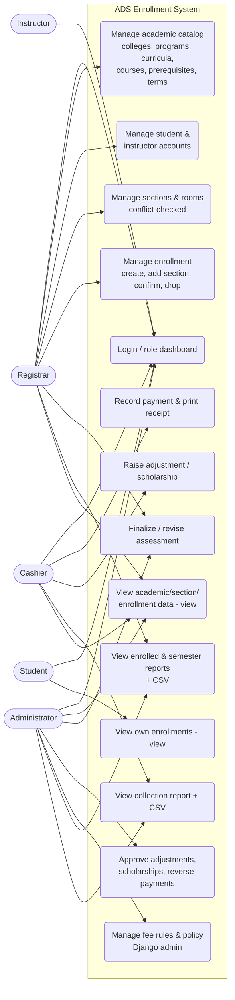

# E2 — Use Case Diagram

Only **genuinely implemented** interactions are shown (no invented use cases).
Rendered with Mermaid (GitHub/VS Code render this natively). Source is this file.

## Legend / notation

- **Ovals (use cases)** = actions the system supports.
- **Actors (left/right)** = the five user roles.
- An edge **actor → use case** means that role can perform it (server-side
  enforced).
- Read-only use cases are suffixed "(view)". Administrator management of fee
  rules / policy / users is via the Django admin site (`is_staff` + Administrator
  role).

## Explanation

- **Registrar** owns academic/people/section/enrollment management and finalizes
  or revises assessments; can view the enrolled/semester reports.
- **Cashier** records payments and prints receipts, raises adjustments/
  scholarships for approval, and views the collection report.
- **Administrator** is read-only on the in-app academic/enrollment screens, but
  approves finance adjustments/scholarships, reverses payments, finalizes/revises
  assessments, manages fee rules and policy (Django admin), and views all
  reports.
- **Instructor** currently has login + a role dashboard only (no roster/grading
  screens — intentionally not shown, as they are not implemented).
- **Student** has login + a read-only view of their own enrollments; students
  cannot self-enroll or view other students' records.
